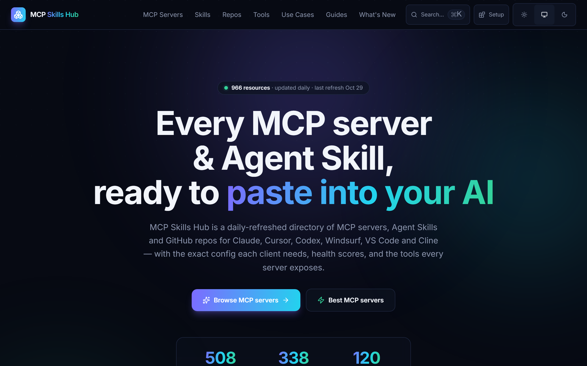
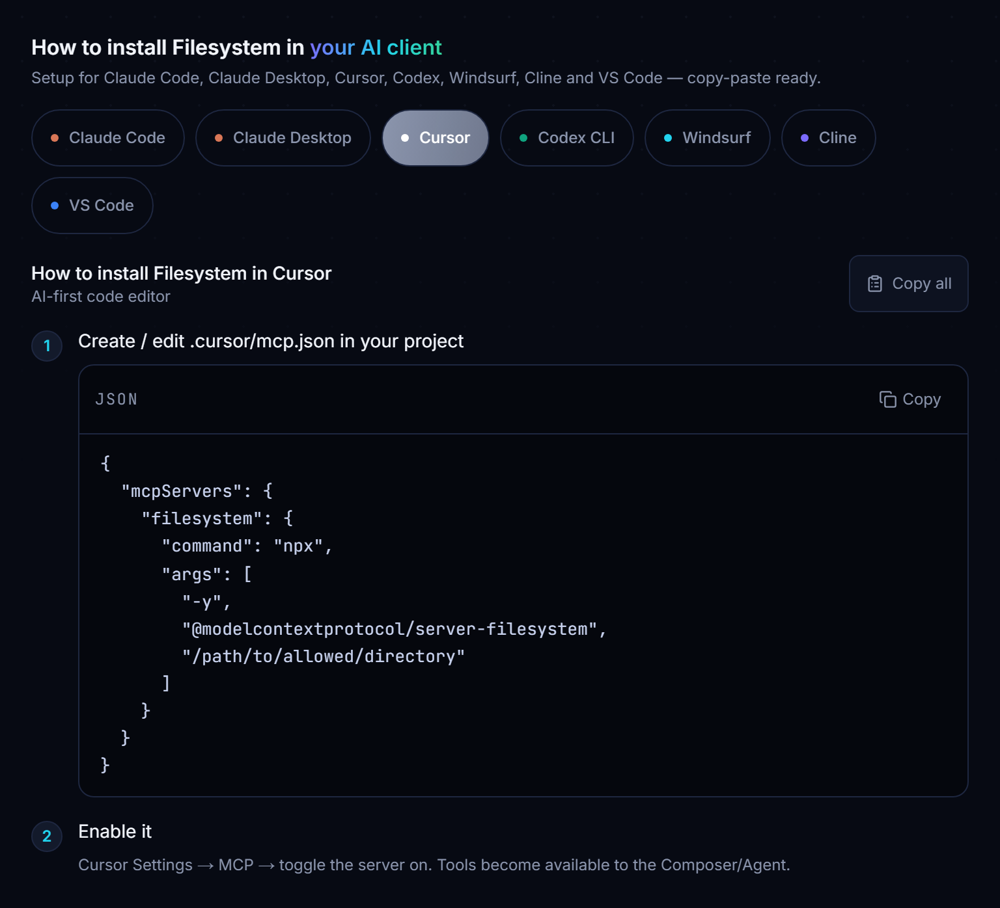
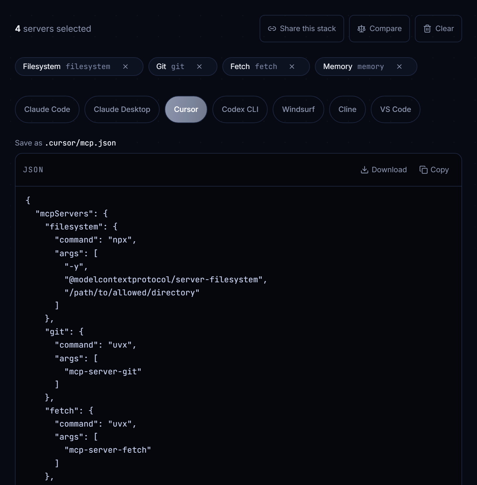
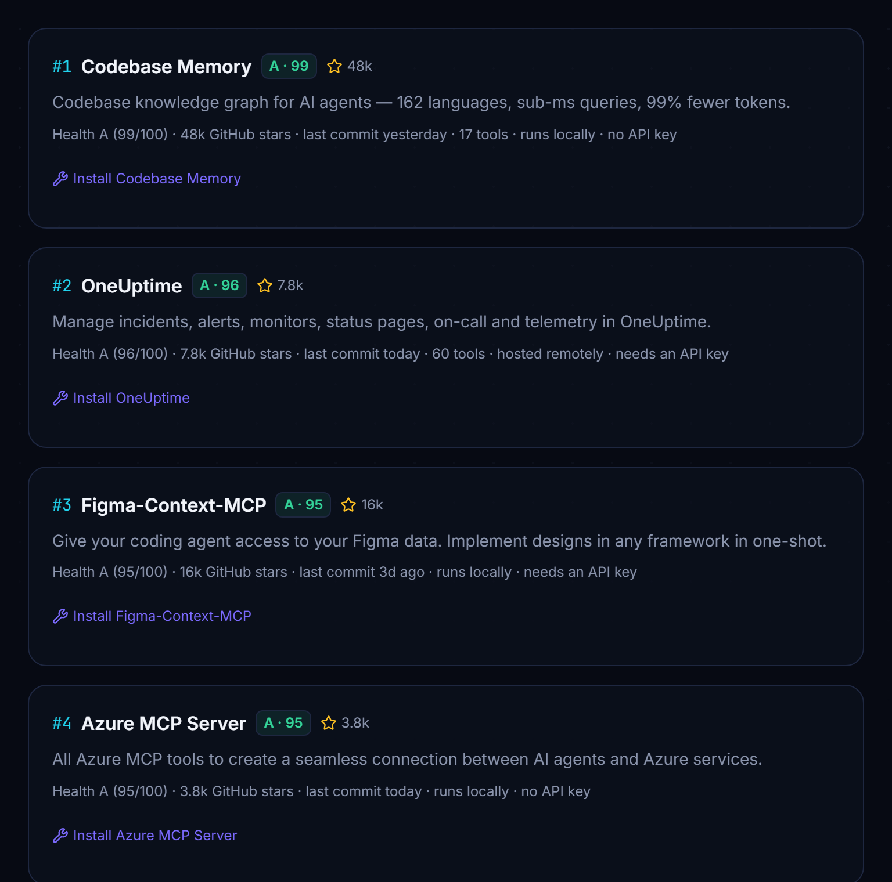
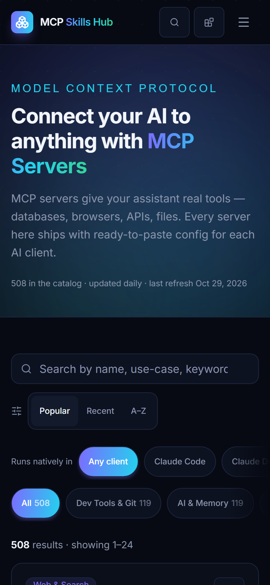

<div align="center">

<a href="https://mcp-skills-hub.vercel.app">
  
</a>

# MCP Skills Hub

**Find the right MCP server or Agent Skill — and get a config that actually works in your client.**

[](https://mcp-skills-hub.vercel.app/mcps)
[](https://mcp-skills-hub.vercel.app/skills)
[](https://mcp-skills-hub.vercel.app/repos)
[](https://github.com/neeelbhavsar/mcp-skills-hub/actions/workflows/refresh-data.yml)
[](LICENSE)
[](https://github.com/neeelbhavsar/mcp-skills-hub/stargazers)

**[Open the site](https://mcp-skills-hub.vercel.app)** ·
**[Best MCP servers](https://mcp-skills-hub.vercel.app/best-mcp-servers)** ·
**[Config generator](https://mcp-skills-hub.vercel.app/setup)** ·
**[Setup guides](https://mcp-skills-hub.vercel.app/clients)** ·
**[API](https://mcp-skills-hub.vercel.app/developers)**

Works with **Claude Code · Claude Desktop · Cursor · VS Code · Windsurf · Cline · Codex**
Nothing to install — it's a website. Refreshed every morning from the official MCP Registry.

</div>

> [!TIP]
> If it saves you from hand-editing one more `mcp.json`, a ⭐ helps other developers find it.

---

Every directory can show you a list. The trouble starts *after* you pick something:

1. **The config you copy is wrong for your client.** Each one wants a different file, key and shape — and remote servers need a different config from local ones.
2. **You can't tell whether it's maintained, or what it can do on your machine.**
3. **Installing five servers means hand-merging five JSON blocks** — and remembering which need an API key.

MCP Skills Hub is built around those three problems.

## 🎯 Install steps that are right for your client

Every server page has copy-paste steps for **all seven clients**, generated from the server's real transport — not one generic snippet.



|  | Remote server | Local (packaged) server |
|---|---|---|
| **Claude Code** | `claude mcp add --transport http …` | `claude mcp add name -- npx -y <pkg>` |
| **VS Code** | `"servers"` + `"type": "http"` | `"servers"` + `"type": "stdio"` |
| **Cursor** | `url` | `command` + `args` |
| **Windsurf** | `serverUrl` (not `url`) | `command` + `args` |
| **Cline** | `"type": "streamableHttp"` | `command` + `args` |
| **Claude Desktop / Codex** | bridged through `mcp-remote` | native |

Required arguments and API keys are filled in as placeholders (`<GITHUB_TOKEN>`), so the config never *looks* complete and then fails on first launch. One-click install links for VS Code and Cursor are on every page too.

## 🧰 One config for every server you need

Tick servers as you browse, then open the **[config generator](https://mcp-skills-hub.vercel.app/setup)**: one merged file for your client, with the `mcp-remote` bridges inserted where it needs them.



- **Download** the file, or copy it
- **Pin package versions** so the whole team runs the same code
- **Project `.mcp.json`** for Claude Code, ready to commit
- **Share a stack** as a link — or start from a [curated collection](https://mcp-skills-hub.vercel.app/stacks)

## 🛡️ Know what you're installing

An MCP server runs with your credentials, and a local one executes code on your machine. Every server page states, with sources:

- **What the code can do** — the published npm package is downloaded and parsed (never run), and every capability it reaches for is listed with the file and line
- **How it was published** — trusted-publisher identity, provenance, maintainers, install scripts
- **Whether it's maintained and used** — last commit, archived, stars, weekly downloads, deprecation
- **A transparent [health score](https://mcp-skills-hub.vercel.app/health-score)** — every component and weight is published; anything that can't be measured is left out rather than scored as zero

These are signals, not a safety verdict. The page says what it knows, cites where it saw it, and lets you decide.



## 🔎 Find a server by what it does

- **[Best MCP servers](https://mcp-skills-hub.vercel.app/best-mcp-servers)** — ranked by health score, recomputed daily, with the reason each made the list
- **[Search by tool](https://mcp-skills-hub.vercel.app/tools)** — *which server has a `create_issue` tool?* Tool lists are read from the live servers, or from their docs
- **[Use cases](https://mcp-skills-hub.vercel.app/use-cases)** — query Postgres, automate a browser, work with GitHub
- **[Setup guides](https://mcp-skills-hub.vercel.app/clients)** — where each client keeps its config, and fixes for the errors everyone hits
- **⌘K search** across every server, skill, repo and tool

<p align="center"></p>

## 🤖 Use it from your assistant

An MCP server that finds MCP servers. Ask *"find me an MCP server for Postgres and install it"* — your assistant searches the catalog and hands back the config.

```bash
# from a clone of this repo — an npm package (npx -y mcp-skills-hub) is on the way
claude mcp add mcp-skills-hub -- node /absolute/path/to/mcp-skills-hub/mcp-server/index.mjs
```

Or query the data directly — read-only, no key, CORS open:

| Endpoint | Contents |
|---|---|
| [`/api/mcps`](https://mcp-skills-hub.vercel.app/api/mcps) | Every server: launch config, health score, trust signals, credentials, tools |
| [`/api/skills`](https://mcp-skills-hub.vercel.app/api/skills) · [`/api/repos`](https://mcp-skills-hub.vercel.app/api/repos) | Every Agent Skill and repo |
| [`/md/mcps/<slug>`](https://mcp-skills-hub.vercel.app/md/mcps/official-filesystem) | Any server page as Markdown, with install steps for every client |
| [`/llms.txt`](https://mcp-skills-hub.vercel.app/llms.txt) · [`/llms-full.txt`](https://mcp-skills-hub.vercel.app/llms-full.txt) | The catalog for language models |
| [`/openapi.json`](https://mcp-skills-hub.vercel.app/openapi.json) · [`/feed.xml`](https://mcp-skills-hub.vercel.app/feed.xml) | OpenAPI description · RSS of new servers |

## 🏷️ Maintain an MCP server? Add your badge

Every listed server has a live badge showing its health grade — copy the snippet from your server's page:

```markdown
[](https://mcp-skills-hub.vercel.app/mcps/official-filesystem)
```

Not listed, or something wrong? **[Submit or correct it](https://mcp-skills-hub.vercel.app/submit)**.

## Where the data comes from

A GitHub Action rebuilds the catalog every morning at 06:00 UTC.

| Catalog | Sources |
|---|---|
| **MCP servers** | The [official MCP Registry](https://registry.modelcontextprotocol.io) (all ~20,000 entries read, the best-ranked kept) and the reference servers from [`modelcontextprotocol/servers`](https://github.com/modelcontextprotocol/servers) — enriched from npm, PyPI and GitHub |
| **Skills** | [`anthropics/skills`](https://github.com/anthropics/skills), `claude-plugins-official`, and community awesome-lists |
| **Repos** | GitHub Search, star-ranked by topic |

## Contributing

Contributions are very welcome — see **[CONTRIBUTING.md](CONTRIBUTING.md)**. Good places to start:

- **Report a config that doesn't work** in your client — the most valuable bug there is
- **Suggest a server or skill** that's missing
- **Add a use case** — one entry in [`src/lib/use-cases.ts`](src/lib/use-cases.ts)
- **Add an AI client** — one entry in [`src/lib/ai-targets.ts`](src/lib/ai-targets.ts)

<details>
<summary><b>Running it locally</b></summary>

<br>

Next.js 16 (App Router) · Tailwind v4 · no database. The catalog is static JSON committed to `src/data/`, every page is pre-rendered, and the whole site is CDN-cacheable.

```bash
npm install
npm run dev            # http://localhost:3000
npm run data           # refresh src/data/*.json (optional — data is committed)
npm run build
npm run lint
```

**`GITHUB_TOKEN` enables trust signals.** Stars and maintenance data come from the GitHub GraphQL API. Without a token the pipeline skips those fields rather than hitting the unauthenticated rate limit. CI supplies one automatically.

```bash
GITHUB_TOKEN=ghp_… npm run data
```

The pipeline never overwrites a non-empty data file with an empty fetch, keeps the catalog stable between runs (a listed server stays while the registry still has it), and only commits — and so redeploys — when something a visitor would notice has changed. See [`scripts/lib/signature.mjs`](scripts/lib/signature.mjs).

| File | Role |
|---|---|
| [`src/lib/ai-targets.ts`](src/lib/ai-targets.ts) | Per-client config generation, deep links, merged configs |
| [`src/lib/compat.ts`](src/lib/compat.ts) | Launch resolution and the client support matrix |
| [`src/lib/health.ts`](src/lib/health.ts) · [`src/lib/trust.ts`](src/lib/trust.ts) | Health score and trust signals |
| [`scripts/`](scripts) | The daily data pipeline |
| [`mcp-server/`](mcp-server) | The directory, as an MCP server |

</details>

## Star history

<a href="https://star-history.com/#neeelbhavsar/mcp-skills-hub&Date">
  
</a>

---

<div align="center">

**[Open MCP Skills Hub →](https://mcp-skills-hub.vercel.app)**

Built by [Neel Bhavsar](https://neelbhavsar.vercel.app/) · [MIT License](LICENSE)
*Not affiliated with Anthropic, OpenAI or Cursor. Listed resources belong to their respective owners.*

</div>
